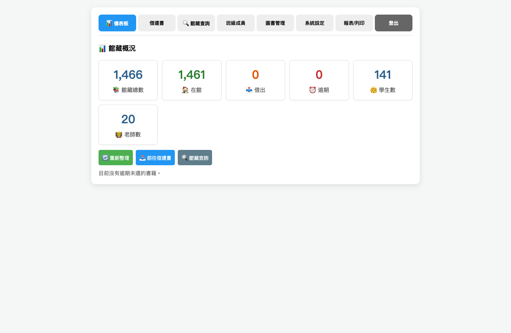
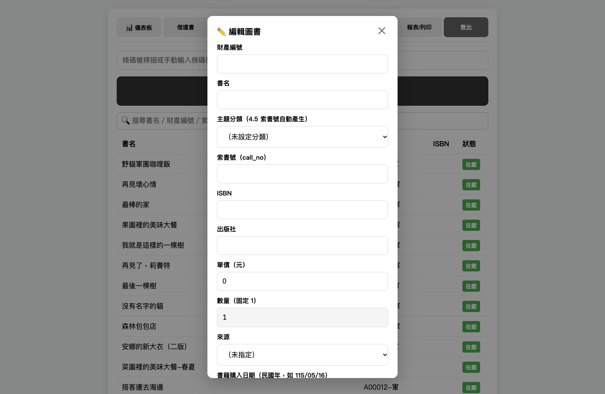
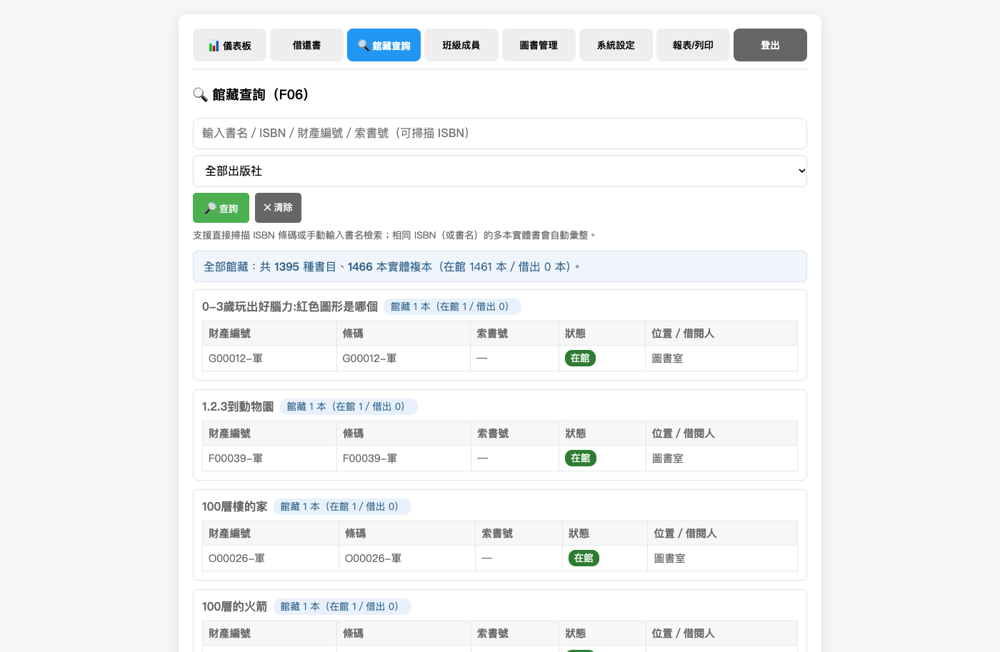
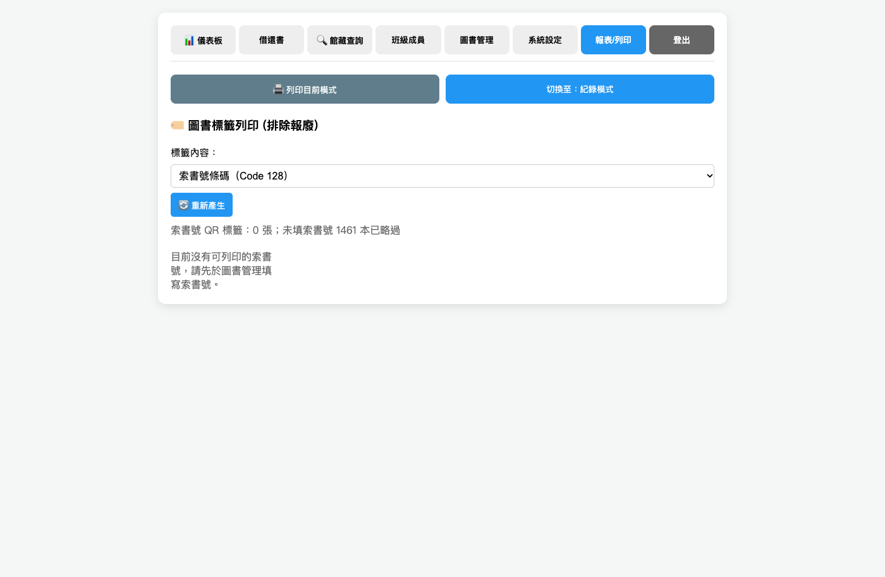

# 海育非營利幼兒園圖書管理系統 — 使用說明書

※ 本文畫面擷圖中的姓名、Email 為匿名化的示意資料，實際畫面會顯示真實班級與成員。

---

## 目錄

1. [第一次使用](#第一次使用)
2. [登入畫面及儀表板 (0.1 / 0.2)](#登入畫面及儀表板)
3. [權限分級與多帳號管理 (1.1)](#權限分級與多帳號管理)
4. [借閱期限、借閱數量上限與續借 (1.2)](#借閱期限借閱數量上限與續借)
5. [逾期提醒及報表 (1.3)](#逾期提醒及報表)
6. [已歸還歷史紀錄 (1.4)](#已歸還歷史紀錄)
7. [一鍵清楚借閱紀錄 (1.5)](#一鍵清楚借閱紀錄)
8. [學籍批次處理與學期轉換／升級 (2)](#學籍批次處理與學期轉換升級)
9. [安全性：資料庫、備份、密碼自救機制 (3)](#安全性資料庫備份密碼自救機制)
10. [圖書館藏與財產管理 (4)](#圖書館藏與財產管理)
11. [加快借還書速度 (5)](#加快借還書速度)
12. [館藏查詢系統 (6)](#館藏查詢系統)
13. [報表／列印功能 (7)](#報表列印功能)
14. [上線後交付文件 (8)](#上線後交付文件)
15. [常見問題](#常見問題)

---

## 第一次使用

1. 打開瀏覽器，輸入網址進入系統  
   （由圖書管理員告知網址；本園上線環境通常是 `http://<伺服器IP>:8080/index.html`，本機則是 `http://localhost:8080/index.html`）
2. 輸入管理密碼（預設為 `1234`）登入；如有個人帳號，可填帳號、姓名或 Email
3. 進入「系統設定 → 修改密碼」，**改成自己的密碼**

⚠️ 預設密碼 `1234` 寫在功能規格文件上，任何人看過文件就能進入系統。  
第一件事就是把它改掉。

---

## 登入畫面及儀表板 (0.1 / 0.2)

### 0.1 登入畫面樣式

系統開啟後，登入畫面選擇「帳號密碼登入」。

- 「帳號密碼登入」：需要管理者登入帳號及密碼，才能登入系統。
- 登入畫面展示「海育非營利幼兒園」與「圖書管理系統」標題。

登入畫面的「帳號」欄位可填入下列任一項，再輸入密碼：

1. 帳號（例如 `026`）
2. 姓名（需與「班級成員管理」中登入用姓名完全相同）
3. Email（不分大小寫）

填帳號 + 密碼登入者，對應 `users` 表中的帳號（系統管理員 / 老師 / 學生），角色會決定預設的借閱類型（學生 / 老師）。  
若姓名或 Email 同時對應多個帳號，系統會要求改用帳號登入，避免登入錯誤對象。  
未填帳號、只輸入管理密碼者，登入為系統管理員（備援）。

### 0.2 儀表板 (館藏概況)

登入後，儀表板為管理系統首頁（左上角會顯示系統名稱「海育非營利幼兒園圖書管理系統」）。

儀表板顯示基本圖書管理資訊：

| 項目 | 說明 |
|------|------|
| 📚 館藏總數 | 系統中所有書籍筆數 |
| 🏠 在館 | 目前可借閱的書籍（狀態為「在館」） |
| 📤 借出 | 目前外借中的書籍（狀態為「借出」） |
| ⏰ 逾期 | 已超過應還日期尚未歸還的書籍 |
| 🧒 學生數 | 啟用的學生成員人數（不含系統管理員） |
| 👨‍🏫 老師數 | 啟用的老師／教職員成員人數（不含系統管理員 Root 與日常管理員） |

若逾期數大於 0，建議到「報表/列印」頁面載入「逾期未還清單」進行追蹤。

### 管理員功能二次密碼 (0.2)

登入後，畫面上的功能若屬於系統管理員功能（系統設定、報表列印），需要再次輸入管理密碼，才能使用。點擊「系統設定」或「報表/列印」頁籤時，會彈出密碼驗證視窗，輸入正確管理密碼後才能進入該頁面。

---

## 權限分級與多帳號管理 (1.1)

系統設有五項獨立功能權限，可逐帳號勾選：

| 權限 | 對應功能頁面 |
|------|-------------|
| 📖 借還書 (canLoan) | 借還書頁面 |
| 👥 班級成員 (canMember) | 班級成員管理 |
| 📚 圖書管理 (canBook) | 圖書管理 |
| ⚙️ 系統設定 (canConfig) | 系統設定 |
| 📊 報告／列印 (canReport) | 報表／列印 |

所有帳號（含各班學生）都可以勾選；勾選中的項目會亮藍色標示。  
未勾選的功能：導覽列不會出現該頁籤，直接切換也會被擋下（後端同步檢查）。  
admin／root 角色與共用管理員不受勾選影響，一律全權限。

建議：一般學生保持只勾「📖 借還書」即可；協助管理圖書的教職員再另外開「📚 圖書管理」「👥 班級成員」。

---

## 借閱期限、借閱數量上限與續借 (1.2)

「系統設定 → 借閱規則」可調整：

| 身份 | 借閱數量上限 | 借閱期限 |
|------|-------------|---------|
| 學生 | 每人每次最多 3 本 | 7 日 |
| 老師 | 每人每次最多 90 本 | 一學期（預設 180 天） |

修改後立即生效，借書時會依角色套用對應上限，並設定到期日。

### 📅 老師借閱至學期末（學期起訖）

在「系統設定 → 借閱規則」填寫「老師借閱至學期末」的起始日與結束日（例如 `2026-09-01` ～ `2027-01-31`），老師借書時的應還日期會直接設為該學期結束日（23:59:59），取代固定天數；留空則沿用天數設定（預設 180 天）。系統管理者須能自由調整每學期開學日及還書到期日。

### 續借功能

書籍在「借出」狀態時，可點「🔁 續借」延長到期日。續借後到期日會依成員身份（學生／老師）重新計算。

---

## 逾期提醒及報表 (1.3)

「報表/列印」頁面提供「逾期未還清單」，列出借出中且已過期的書籍。  
可依「班級」與「師生」（全部／學生／老師）篩選，並可下載 PDF。

---

## 已歸還歷史紀錄 (1.4)

增加 F06 館藏查詢系統，供老師隨時調閱學生或老師本人的已歸還歷史紀錄。  
當發生「這本書你上個月借了沒還」的爭議時，老師能快速打出「姓名 115 學年借還紀錄明細」的介面來釐清誤會。

---

## 一鍵清楚借閱紀錄 (1.5)

為了避免借閱紀錄無限膨脹，管理者可以於每學期末或每學年末，盤點書籍狀態後，將「狀態」設定為「遺失、修繕中、爭議中」，「備註」欄位可自由填寫文字。借閱紀錄僅維持每學年有效，資料庫不會持續膨脹。

---

## 學籍批次處理與學期轉換／升級 (2)

### 2.1 批次匯入功能

幼兒園每年暑假都會經歷大規模的學生異動（大班畢業、中／小班升級、新生入學）。系統提供 Excel／CSV 批次匯入學生名單的功能，避免開學初逐筆手動輸入。

系統上線前，廠商提供 Excel 範本供幼兒園填寫提供最新的老師名單（以員工編號條列）及最新的學生名單（以每班學生編號條列）。每學年重新編班、新生編學號。

以每學年為單位，可查詢學生借過哪些書。系統設定以學年為週期（例如 `a01` 即為閱讀紀錄僅每學年有效，在每學期末進行帳務結清，若有爭議或遺失狀態記錄到書籍狀態做為追蹤），借閱紀錄僅維持每學年有效，資料庫不會持續膨脹，較不佔儲存空間。

### Excel 範本下載 (2.1)

「系統設定 → 批次匯入」頁面提供下載範本：

- **下載名單 Excel／CSV 範本**：含「老師名單」（員工編號、姓名、班級、角色）與「學生名單」（學號、姓名、班級、角色）兩個工作表，以及填寫說明
- **下載圖書 Excel 範本**：含「圖書匯入」（條碼、書名、財產編號、出版社、單價、ISBN、索書號、來源、書籍購入日期、保管人、確認、盤點日期、備註）與填寫說明

下載後以 Excel 填寫，再透過「名單批次匯入」／「圖書批次匯入」匯入系統。

### 學年編號重置 (2.1)

在「系統設定 → 🔢 學年編號重置」：  
每學年重新編班後使用，將所有學生學號從各班 `a01` 起重新編排（格式：`S`＋班級代碼＋序號，如 `SA01`、`SB01`）。依班級排序，班內依姓名排序。重設後會影響條碼掃描識別，請確認後再執行。

---

## 安全性：資料庫、備份、密碼自救機制 (3)

### 3.1 系統資料庫架構要求

- 系統採用獨立資料庫系統（SQLite），確保資料持久性。
- 採用本機端資料庫，內建「每日自動備份至指定目錄或雲端硬碟」之功能。
- 備份檔採循環覆蓋機制：備份檔保留 10 天，第 11 天自動覆蓋最早一天（Day 1）的備份。
- 建議採用「本機端 搭配 Google Drive 自動備份」或「幼兒園的另一台電腦儲存備份檔案」方案。

### 自動備份設定 (3.1)

在「系統設定 → ⏰ 自動備份設定」：

- **備份目錄**：備份檔案的儲存位置，預設為 `data/backups`，可改為 NAS 或雲端磁碟掛載點路徑（即實現「雲端備份」）。
- **備份時間**：每日自動備份的時刻（預設 02:00），可由管理者設定。

系統會於設定時間自動執行備份，且僅保留最近 10 份備份，較舊者自動刪除。亦可點「💾 手動執行自動備份」立即備份一次。

### 3.2 執行檔封裝要求

- 自帶微型伺服器（以 `http://localhost` 或自訂本機網址運行）。
- ⛔ 嚴禁直接以 `file:///` 協定開啟網頁。

### 3.3 密碼自救機制

系統須內建免網路連線之密碼重置功能，避免密碼遺失導致系統永久鎖死。

#### 解法 1：離線安全提問

系統初次設定時，強制管理員設定安全提問（例如「開園日期？」、「園長姓名？」）。  
忘記密碼時，只需在登入畫面點擊「忘記密碼」並答對設定的問題，即可直接在畫面上重設密碼。

#### 解法 2：雙軌制最高管理帳號

系統不可僅有一組管理員帳號。必須建立「系統管理員（園長／行政）（日常用）」與「系統 Root（備用）」兩組最高權限帳號。配套措施：將「系統 Root」的帳號密碼寫在紙上，鎖在幼兒園的實體保險箱。當日常帳號忘記密碼被鎖死時，用備用帳號登入去幫日常帳號重設密碼。

---

## 圖書館藏與財產管理 (4)

### 4.1 書目詳細資訊

書籍建檔的欄位順序，比照幼兒園現行財產清冊的順序。欄位由左至右順序，請依照財產編號、書名、出版社、單價、數量、總金額、書籍購入日期、保管人、確認、盤點日期、ISBN、來源、備註、預約狀態。

財產編號與書名是必要欄位，於系統登打完成就可以建檔完成進行儲存。

財產編號是每一本書的唯一號碼。

#### 🏷️ 圖書編輯對話框欄位 (4.1 財產欄位)

開啟「編輯圖書」對話框後，除了原本的財產編號、書名、索書號、ISBN，下方還有以下欄位可填寫：

| 欄位 | 說明 | 範例 |
|------|------|------|
| 出版社 | 書籍出版社 | 上誼、康軌 |
| 單價（元） | 購買單價，整數 | 280 |
| 數量 | 固定為 1（不可更改） | 1 |
| 總金額 | 單價 × 數量 | 280 |
| 來源 | 自購／軍購／捐贈／英補／署補 | 自購 |
| 書籍購入日期 | 民國年格式，如 115/05/16 | 115/05/16 |
| 保管人 | 實際保管該書的人員 | 總務處 |
| 確認 | 核對備註 | 已核 |
| 盤點日期 | 最近盤點日期，民國年格式 | 115/06/01 |
| 報廢日期 | 書籍報廢時填寫，民國年格式 | 116/12/31 |
| 預約狀態 | 有被預約／無被預約（系統即時顯示，唯讀） | 無被預約 |

當「書籍狀態」設定為「遺失、修繕中、爭議中」：設定為無法借出。

### 4.2 「備註」欄位

（非必要填寫欄位）  
註記「瑕疵與缺件」或其他可能狀態。例如幼兒園的書（尤其是附 CD、字卡或翻翻書）極易發生「書還能看，但少了一頁／少了一張卡」的情況。

### 4.3 書籍狀態一覽表

| 狀態名稱 | 說明 |
|---------|------|
| 在館 | 書籍正常在架上，可供借閱。 |
| 借出 | 書籍已被借出，系統記錄借閱人與到期日。 |
| 遺失 | 幼兒把書弄丟。為「報廢」之前的緩衝狀態，可於備註欄記錄賠償進度。若家長已買回原書則註銷「遺失」狀態。 |
| 修繕中 | 破損但未達報廢標準，老師進行膠帶修補。此狀態讓書在查詢系統上暫時下架，避免學生預約或尋找，修補完成後恢復為「在館」。 |
| 爭議中 | 書籍此時既非在館，也無法證實遺失。為「爭議中／尋找中」的緩衝狀態，暫停計算逾期。 |
| 報廢 | 書籍已報廢，無法借出或歸還。 |

### 4.4 預約功能

（系統先開發此功能，暫時不開啟使用）  
當圖書狀態為「借出」時，提供下一位幼兒「預約排隊」的功能。只有「借出中」的書可以預約（在館的書直接借閱即可，系統會擋下）。同一成員同一本書同時只能有一筆「進行中」預約。

---

## 加快借還書速度 (5)

### 5.1 學生借閱條碼 (條碼體系)

系統自動為每位學生（依照學號）生成一組專屬的條碼 (QR Code)，具備批次列印「全園學生條碼名冊」及「某一班幼兒條碼名冊」及「全園老師條碼名冊」的功能。

成員條碼格式：學生 **SA+班級代碼+號碼**（例如 `SA01`），老師 **T+員工編號**（例如 `T001`）。在「借還書」頁直接掃描成員條碼 QR，即可快速選定該位借閱人，無需手打姓名。

### 5.2 功能指令條碼 (Command Barcode)

老師在「借書」與「還書」模式之間切換，通常也要移動滑鼠去點擊網頁按鈕。系統批次產出幾組特殊的系統指令條碼，例如：「啟動借書模式」、「啟動還書模式」及「清除重來」。

將這幾個指令條碼印出來，護貝貼在電腦螢幕邊框或桌面上。

操作流程：

1. 掃碼「啟動借書模式」，系統會自動切換螢幕畫面進入「借還書頁面」且滑鼠游標指向借書模式的「借閱者條碼」欄位。
2. 掃碼「借閱者條碼」會自動輸入條碼數字在「借閱者條碼」欄位後，自動跳轉下個欄位「掃描圖書條碼借書」欄位。
3. 掃碼「書籍條碼」會自動輸入條碼數字在「圖書條碼」欄位，系統會跳轉顯示操作紀錄。

還書第一步：掃碼「啟動還書模式」，系統會自動切換螢幕畫面進入「借還書頁面」且滑鼠游標指向還書模式的「掃描圖書條碼還書」欄位。

### 5.3 營運端：設立「還書箱」延遲批次處理

還書動作不需要在幼兒面前「即時」完成。在公共區域或各班設置一個實體的「還書箱」。學生早上來學校直接把書丟進還書箱。到了中午午休或放學後，再由單一行政人員或志工，推著還書箱到電腦前進行「連續批次還書」。

---

## 館藏查詢系統 (6)

### 6.1 館藏查詢系統優化要求

增加 F06 館藏查詢系統，目前只有系統管理員能看到報表，所以需要一個讓老師能簡單搜尋「某本書現在是在館還是借出」的查詢介面。

- 支援 ISBN 與書名查詢：查詢介面需支援直接掃描 ISBN 或手動輸入書名進行檢索。
- 複本彙整顯示（庫存查詢）：系統需能辨識具有相同 ISBN（或相同書名）之多本實體書（複本），並於搜尋結果中彙整顯示。
- 需明確標示該書之「館藏總數」，以及每一本實體書（依財產編號區分）的「目前狀態（在館／借出／遺失等）」與「所在位置（如：圖書室／班級代管）」，方便老師快速掌握庫存狀況。

### 6.2 進階篩選與統計介面設計

關鍵字搜尋與下拉選單：在館藏查詢的首頁，除了搜尋「書名」或「ISBN」之外，增加一個「出版社」的搜尋框或下拉選單。

一鍵統計總數：當老師在搜尋框輸入「上誼」或「康軒」並按下搜尋後，系統不只列出書單，還必須在畫面上方顯示彙整統計數據。

例如：「您搜尋的出版社為【上誼】，本園共有 45 種書目，總計 120 本實體複本（目前在館：105 本，借出：15 本）。」

---

## 報表／列印功能 (7)

系統所有清單與統計報表，除了畫面預覽外，皆須支援下列匯出格式：PDF、xlsx、csv。匯出之中文編碼必須確保於 Microsoft Excel 開啟時不會產生亂碼（採用 UTF-8 with BOM 編碼）。

### 7.1 匯出格式要求

條碼名冊：PDF（因為是條碼名冊，用 PDF 固定列印位置）。  
清冊：xlsx 或 csv（匯出原生 Excel 工作表格式，以利後續人工加值運算與建檔）。

### 7.2 列印項目

#### 報表表頭 (7.2)

「書籍財產清冊」及「書籍報廢清冊」報表上方（或稱表頭）需有以下資訊：

1. **國防部海軍司令部海育員工子女非營利幼兒園(委託社團法人高雄市社區教育協會辦理)**
2. **列印日期**

#### 五款自黏貼紙格式 (7.2)

在「報表/列印 → 標籤模式」可選擇貼紙格式，列印時會自動調整欄數：

| 格式 | 排列 | 張數/A4 | 適用 |
|------|------|---------|------|
| AK308 | 3 × 8 | 24 張 | 預設格式，一般書籍標籤 |
| AK307 | 3 × 7 | 21 張 | 較大標籤 |
| AK306 | 3 × 6 | 18 張 | 較大標籤 |
| AF414 | 4 × 14 | 56 張 | 小型標籤，數量多時節省紙張 |
| AF410 | 4 × 10 | 40 張 | 小型標籤 |

其他列印項目是列印在 A4 的一般紙上，列印格式將預設為一張 A4 紙 3×8 張 QR Code 條碼。

若列印出來的 QR Code 標籤，因尺寸過小，導致掃描容易報錯，將建議調整一張 A4 紙可列印的數量。

※ 索書號標籤現在使用 **QR Code**（規格 v2.2 7.2 要求 QR），掃描更容易、容錯率更高。

#### 清冊列印項目

| 報表名稱 | 條碼形式 | 說明 |
|---------|---------|------|
| 書籍財產清單條碼名冊 | QR Code | 財產編號、書名、出版社、單價、數量、總金額、書籍購入日期、保管人、確認、盤點日期 |
| 書籍索書號清單條碼名冊 | QR Code | 索書號清冊，以索書號排序 |
| 全園學生條碼名冊 | QR Code | 以班級為單位，一班一張 A4 |
| 全園老師條碼名冊（不含系統管理者） | QR Code | 排除 Root 與日常管理員 |
| 功能指令條碼名冊 | QR Code | 「啟動借書模式」、「啟動還書模式」、「清除重來」 |
| 書籍財產清冊（設定日期） | xlsx/csv | 欄位：財產編號、書名、出版社、單價、數量、總金額、書籍購入日期、保管人、確認、盤點日期 |
| 書籍報廢清冊（設定期間） | xlsx/csv | 欄位：財產編號、書名、出版社、單價、數量、總金額、書籍購入日期、保管人、確認、盤點日期、報廢日期 |
| 圖書已借出清冊（設定日期） | xlsx/csv | 可根據各班級或全園產出 |
| 逾期未還清冊（設定日期） | xlsx/csv | 可根據各班級或全園（勾選老師或學生或全部），匯出目前逾期未還書籍的清單 |
| 逾期已還紀錄清冊（設定期間） | xlsx/csv | 可根據各班級或全園（勾選老師或學生或全部），以借閱人為標題逐一列出逾期紀錄清單 |
| 個人閱讀歷程統計清冊（設定期間） | xlsx/csv | 可產出學生（依照特定學號）或老師（依照員工編號）最多 1 學年，總共借閱了多少本書的完整報表 |
| 全園閱讀歷程統計清冊（設定期間） | xlsx/csv | 借閱人（可選擇老師或學生）／借閱總次數 |
| 書籍爭議、遺失、修繕中狀態記錄清冊 | xlsx/csv | 列出狀態為遺失、修繕中、爭議中的書籍 |

#### QR Code 條碼名冊下載

- **書籍財產條碼名冊 (QR)**：從圖書財產名單讀取所有財產編號，生成 QR Code 名冊 PDF。
- **全園學生條碼名冊 (QR)**：從學生名單讀取，以班級為單位分頁，條碼格式 SA+班級+號碼。
- **全園老師條碼名冊 (QR)**：從員工名單讀取，不含系統管理者，條碼格式 T+員工編號。

---

## 上線後交付文件 (8)

1. **功能確認單**：預計上線日完成交付及確認。
2. **操作手冊**：即本文件，預計上線日完成交付及確認。
3. **安裝程式及程式碼檔案**：預計上線日完成交付及確認。

---

## 常見問題

**Q：** 點了「借書」按鈕卻跳出一個錯誤視窗？  
**A：** 多半是瀏覽器沒有允許使用相機。請確認網址是 `http://localhost:8080` 開頭，或是以 `https://` 開頭。直接雙擊 HTML 檔開啟會被瀏覽器阻擋。

**Q：** 條碼槍沒反應？  
**A：**  
1. 確認游標在條碼輸入框上（點一下輸入框）。  
2. 確認條碼槍插好，且檔案結尾是「換行」或「Enter」。  
3. 先手動輸入數字按 Enter 測試看看。

**Q：** 同一本書重複掃了好幾次，會不會重複記錄？  
**A：** 不會。系統內建去重，同一個條碼不會重複處理。

**Q：** 借了書之後，其他老師的畫面看得到嗎？  
**A：** 如果連到同一台伺服器，看得到。請確認大家的網址是同一台電腦（例如 `http://192.168.1.10:8080`），重新整理後就會看到最新狀態。若各自啟動不同的伺服器，則各有一份獨立資料，不會同步。

**Q：** 畫面一直顯示「準備掃描...」？  
**A：** 表示相機沒有啟動。請確認瀏覽器允許相機權限。若網址是 `http://192.168.x.x`（不是 localhost），瀏覽器會封鎖相機，請改用條碼槍，或請管理員以 HTTPS 啟動。

**Q：** 忘記密碼怎麼辦？  
**A：** 點登入畫面的「🔑 忘記密碼？」：  
1. 已設定 Email 的帳號：選「Email 驗證碼」，輸入帳號後收信，再輸入 6 位數驗證碼與新密碼即可。  
2. 共用管理員（帳號留空）若未設定 Email 或寄信失敗：選「本機復原碼」，在伺服器主機開啟 `data/recovery_code.txt`，輸入裡面的復原碼。  
若以上方式都無法使用，請聯絡圖書管理員；管理員可在「班級成員管理」重設個別帳號密碼。極限情況下刪除 `data/library.db` 可重設系統，但館藏資料也會一併消失，所以請務必先備份。

---

## 附錄：系統規格對照表

| 規格章節 | 功能項目 | 系統狀態 |
|---------|---------|---------|
| 0.1 | 登入畫面樣式 | ✅ 已實作 |
| 0.2 | 儀表板（六個概況卡片） | ✅ 已實作 |
| 0.2 | 管理員功能二次密碼 | ✅ 已實作 |
| 1.1 | 五項 can_* 權限分級 | ✅ 已實作 |
| 1.2 | 借閱期限／數量上限（學生 3 本／7 天，老師 90 本／一學期） | ✅ 已實作 |
| 1.2 | 續借功能 | ✅ 已實作 |
| 1.2 | 學期起訖可自由調整 | ✅ 已實作 |
| 1.3 | 逾期未還清單 | ✅ 已實作 |
| 1.4 | 已歸還歷史紀錄（F06 查詢） | ✅ 已實作 |
| 1.5 | 一鍵清楚借閱紀錄 | ✅ 已實作 |
| 2.1 | Excel／CSV 批次匯入學生／教師名單 | ✅ 已實作 |
| 2.1 | Excel 範本下載 | ✅ 已實作 |
| 2.1 | 學年編號重置機制 | ✅ 已實作 |
| 3.1 | SQLite 資料庫＋每日自動備份保留 10 天 | ✅ 已實作 |
| 3.1 | 自動備份時間可設定 | ✅ 已實作 |
| 3.2 | 自帶微型伺服器，禁止 file:/// | ✅ 已實作 |
| 3.3 | 離線安全提問 | ✅ 已實作 |
| 3.3 | 雙軌制管理帳號 (admin/root) | ✅ 已實作 |
| 4.1 | 書目詳細資訊欄位（含總金額、預約狀態） | ✅ 已實作 |
| 4.2 | 備註欄位 | ✅ 已實作 |
| 4.3 | 六種書籍狀態 | ✅ 已實作 |
| 4.4 | 預約排隊機制 | ✅ 已實作 |
| 4.5 | 索書號自動產生（分類代碼＋注音） | ✅ 已實作 |
| 5.1 | SA01／T001 條碼體系 | ✅ 已實作 |
| 5.2 | 功能指令條碼（啟動借書／還書模式、清除重來） | ✅ 已實作 |
| 5.3 | 還書箱批次還書 | ✅ 已實作 |
| 6.1 | 館藏查詢（ISBN／書名／條碼＋複本彙整） | ✅ 已實作 |
| 6.2 | 出版社篩選＋統計 | ✅ 已實作 |
| 7.1 | PDF／xlsx／csv 匯出格式 | ✅ 已實作 |
| 7.2 | 報表表頭園所全稱＋列印日期 | ✅ 已實作 |
| 7.2 | 五款自黏貼紙格式 (AF410/414/AK306/307/308) | ✅ 已實作 |
| 7.2 | QR Code 標籤（取代 Code 128） | ✅ 已實作 |
| 7.2 | 書籍財產條碼名冊 (QR) | ✅ 已實作 |
| 7.2 | 全園學生條碼名冊 (QR) | ✅ 已實作 |
| 7.2 | 全園老師條碼名冊 (QR, 不含管理者) | ✅ 已實作 |
| 7.2 | 功能指令條碼名冊 (QR) | ✅ 已實作 |
| 7.2 | 個人閱讀歷程統計清冊 | ✅ 已實作 |
| 7.2 | 全園閱讀歷程統計清冊 | ✅ 已實作 |
| 7.2 | 書籍爭議／遺失／修繕中狀態記錄清冊 | ✅ 已實作 |
| 7.2 | 逾期已還紀錄清冊 | ✅ 已實作 |
