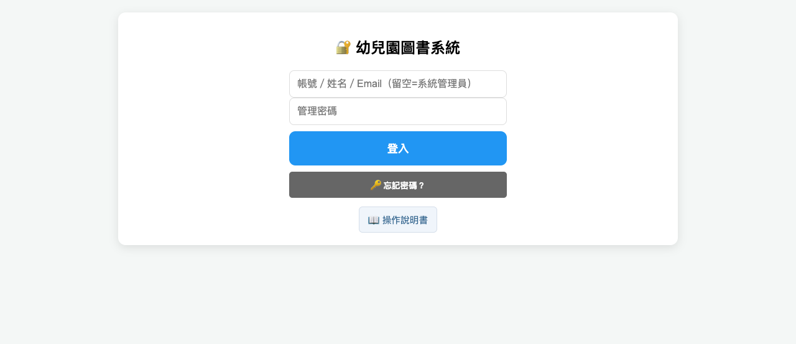
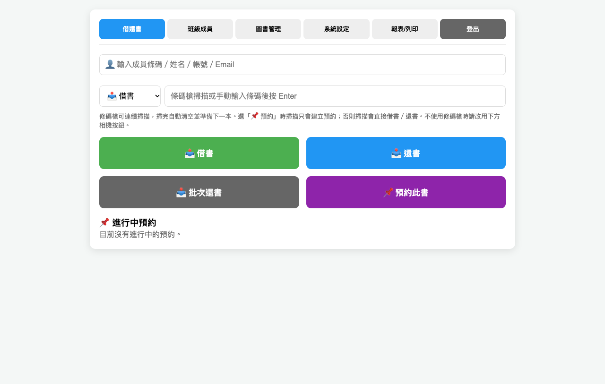
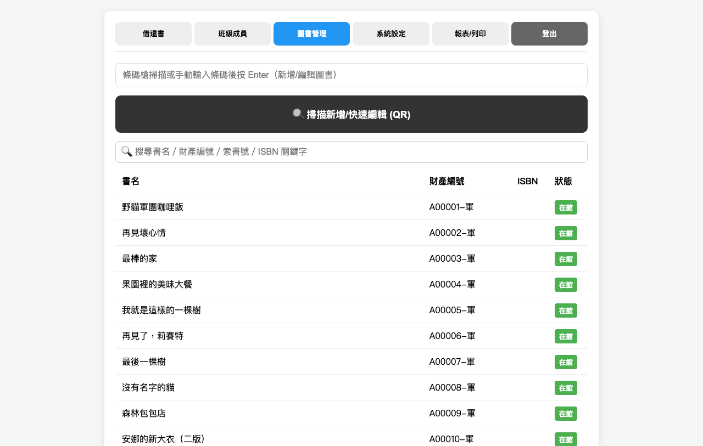
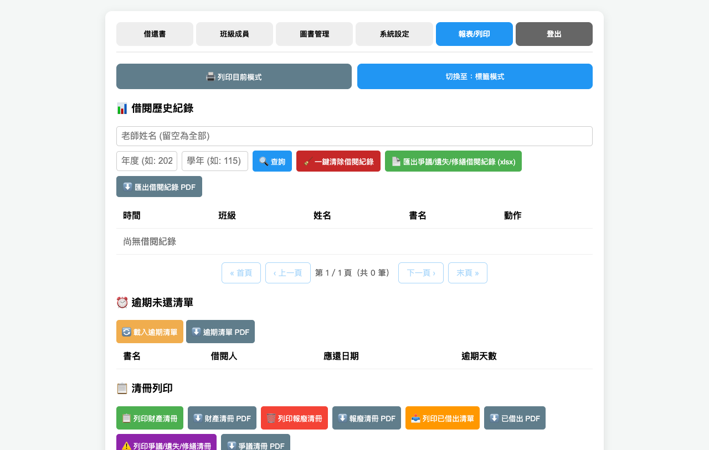
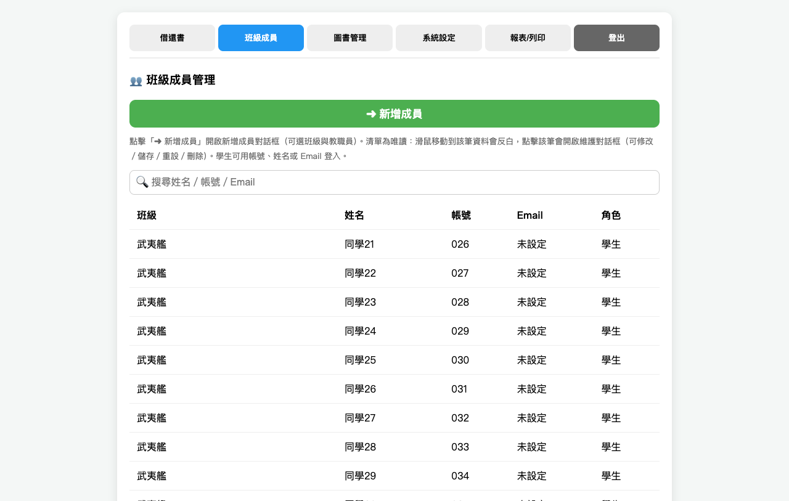
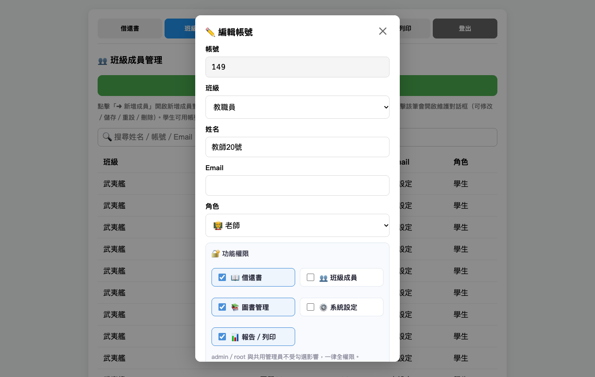
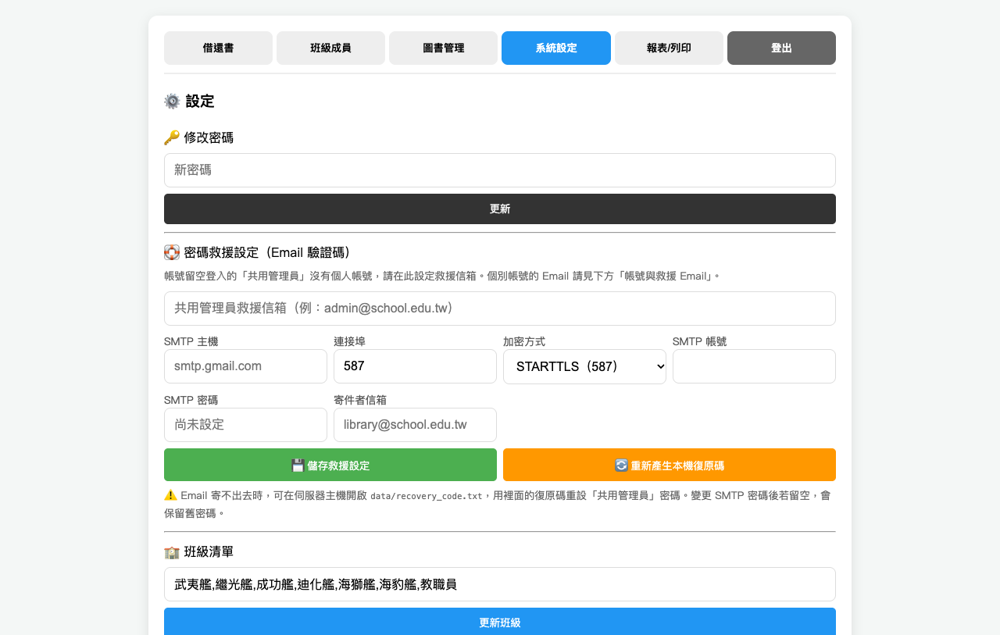

幼兒園圖書資訊管理系統 ─ 操作說明書
==================================

給老師的簡明操作手冊。看不懂的地方請洽圖書管理員。

※ 本文畫面擷圖中的姓名、Email 為匿名化的示意資料，實際畫面會顯示真實班級與成員。

────────────────────────────
第一次使用
────────────────────────────

1. 打開瀏覽器，輸入網址進入系統
   （由圖書管理員啟動伺服器後，通常是 http://localhost:8000/index.html）
2. 輸入管理密碼（預設為 1234）登入；如有個人帳號，可填帳號、姓名或 Email

3. 進入「系統設定 → 修改密碼」，**改成自己的密碼**

⚠️ 預設密碼 1234 寫在功能規格文件上，任何人看過文件就能進入系統。
   第一件事就是把它改掉。

────────────────────────────
日常借書
────────────────────────────

步驟一：選成員
    在「借還書」頁面的輸入框，輸入成員條碼、姓名、帳號或 Email：
    - 掃描成員條碼 QR（格式為 member:班級:姓名）會直接帶出成員。
    - 或手打姓名／帳號／Email，系統會自動比對並顯示「✅ 已選擇：…」。
    選擇後輸入框下方會顯示成員姓名、班級與角色（學生／老師）。

步驟二：選模式
    在條碼輸入框左邊的下拉選單選擇「借書」、「還書」或「預約」。

步驟三：掃描

> 🖨️ **有條碼槍**
> 對準書背條碼「嗶」一下即可。
> 可以連續掃，不用放開、也不用按任何鍵。

> 📷 **沒有條碼槍，用相機**
> 點「借書」或「還書」按鈕開啟相機，
> 將 QR Code 對準方框，掃完會自動回應。

> ⌨️ **手動輸入**
> 在輸入框直接輸入條碼數字，按 Enter。

掃描結果會顯示在畫面上方：

    綠色 ✅  已成功借出／歸還
    黃色 ⚠️  這本書目前借出中／已在館內，不必重複處理
    紅色 ❌  館藏中查不到這本書

看到黃色或紅色可以略過，直接掃下一本，**不用關掉視窗**。

掃完所有書後，按「完成並返回」離開掃描畫面。

────────────────────────────
還書
────────────────────────────

與借書相同，將模式改成「還書」再掃描即可。

※ 系統不會檢查還書的人是不是當初借的人。任何人拿到書都能還，
   對幼兒園來說比較實際。

────────────────────────────
新增圖書
────────────────────────────

進入「圖書管理」頁面：

1. 在條碼輸入框掃描書背條碼
   （或點「掃描新增/快速編輯 (QR)」用相機）
2. 在搜尋框輸入書名／財產編號／索書號／ISBN 關鍵字，可即時搜尋館藏。
3. 點擊書單列表中的任一筆，會開啟「編輯圖書」對話框：
   - 可修改財產編號、書名、索書號、ISBN
   - 按「💾 儲存」儲存變更
   - 按「⚠️ 報廢」標記為報廢（報廢後不可借還）
   - 按「💡 取消報廢」將報廢書籍恢復為「在館」
   - 按「🏷️ 標籤」單獨列印該書 QR 標籤

若掃到的是已存在的書，會帶出原本的名稱供修改。

＊ 建議順序：先把書背貼上 QR Code 標籤，再掃描建檔。

────────────────────────────
報廢與復原
────────────────────────────

「圖書管理」頁面點擊任一書籍列，開啟「編輯圖書」對話框：

    儲存　　修改書名、財產編號、索書號或 ISBN
    報廢　　書損壞或遺失時使用（僅非報廢狀態時顯示）
    取消報廢　將報廢書籍恢復為「在館」（僅報廢狀態時顯示）
    標籤　　單獨列印這一本書的 QR 標籤

報廢後：

- 該書無法再借出或歸還
- 資料仍保留，列表中以紅色顯示
- 按「取消報廢」可復原回「在館」
- 按「永久刪除」才會真正刪除（只有報廢的書才有這個按鈕，在「編輯圖書」對話框中操作）

※ 誤按報廢不用緊張，按「取消報廢」就能還原。

────────────────────────────
QR Code 標籤列印
────────────────────────────

**單本列印**
    圖書管理頁面 → 該書的「🏷️ 標籤」按鈕 → 會直接跳出列印畫面

**全部列印**
    報表/列印頁面 → 切換至：標籤模式 → 選擇標籤內容 → 列印目前模式

**標籤內容**
    • 書名 QR Code＋財產編號（預設，掃描可帶出這本書）
    • 索書號條碼（Code 128，供書架排序與盤點使用）

※ 選「索書號條碼」時，未填索書號的書會自動略過；
  索書號僅支援英數字與半形符號（例如 J 859.6 8774）。
  若條碼含中文，請先改成英數格式。

**列印設定建議**
    • 紙材：A4 自黏標籤紙，選 3 欄 × 8 列 規格
    • 邊界：選「無」或「最小」
    • 勾選「列印背景圖形」

**張貼位置**
    貼在繪本封底左下角，或書脊。
    貼完後建議再貼一段透明膠帶防止磨損。

※ 報廢的書不會列入標籤列印。

────────────────────────────
清冊列印
────────────────────────────

在「報表/列印」頁面下方有「📋 清冊列印」：

    📋 列印財產清冊
        列出所有未報廢的書（含在館、借出、遺失、修繕中、爭議中）
        欄位：財產編號、書名、索書號、狀態、借閱人、備註

    🗑️ 列印報廢清冊
        只列出狀態為「報廢」的書

    📤 列印已借出清單
        列出目前借出中的書、班級、借閱人與應還日期

    ⚠️ 列印爭議/遺失/修繕清冊
        只列出「遺失」、「修繕中」、「爭議中」的書

按下去會直接開啟列印預覽，以 A4 表格輸出，
表格標題列會自動重複，適合整疊交給主任或留存備查。

每個清冊右側都有「⬇️ PDF」按鈕，
可直接下載 PDF 檔（中文正常顯示，可存檔或列印）。

────────────────────────────
個人閱讀歷程統計
────────────────────────────

「報表/列印」頁面的「📖 個人閱讀歷程統計」：

    1. 選擇班級
    2. 選擇姓名
    3. 輸入學年（可留空＝全部學年，例如 115）
    4. 按「📖 列印個人歷程」或「⬇️ 個人歷程 PDF」

畫面會列出該成員在此學年的所有借書／還書紀錄，
並統計借書次數與還書次數。

※ 系統以「班級＋姓名」辨識成員；若同班有同名者，
  請先確認名冊資料。

────────────────────────────
借閱紀錄與報表
────────────────────────────

「報表/列印」頁面可以看到所有借閱歷史，
每頁 100 筆，用下方按鈕翻頁。

若要交給主任或做進一步統計，可按
「📊 匯出借閱紀錄 CSV」，會下載一個 Excel 可以直接開啟的檔案，
包含：時間、班級、姓名、書名、財產編號、條碼、動作。

※ CSV 檔可直接用 Excel 開啟，中文不會亂碼。

若要直接存成 PDF，可按「⬇️ 匯出借閱紀錄 PDF」，
會依目前的老師／年度／學年篩選條件輸出 A4 表格。

📅 學年統計：
「借閱歷史紀錄」可輸入「學年」（民國年，如 115），
只列出該學年的紀錄（115 學年 = 2026/08/01～2027/07/31）。
下方「全園閱讀歷程統計」可載入指定學年的全園借書總次數、
各班級與各成員借書次數。

────────────────────────────
班級與成員管理
────────────────────────────

**新增成員**
    班級成員頁面 → 按「➜ 新增成員」→ 選班級（可選「👨‍🏫 教職員（未分班）」）→ 輸入姓名、Email → 設定角色（老師／學生）→ 按「💾 儲存」
    新增時會自動建立帳號（自動編號，預設密碼 1234），
    學生可用帳號、姓名或 Email 登入。
    若要新增教職員帳號，在班級下拉選單選擇「👨‍🏫 教職員（未分班）」，角色會為老師。

**修改成員帳號**
    班級成員清單為唯讀清單：滑鼠移動到該筆資料會反白，點擊該筆後會開啟帳號維護對話框。
    對話框內可修改「班級、姓名、Email、角色」，按「💾 儲存」；按「🔑 重設密碼」重設密碼；
    按「🗑️ 刪除帳號」移除帳號（班級成員會停用，不刪除密碼與 Email）。
    帳號欄位為自動產生不可改。新增成員從班級成員管理頁面的「➜ 新增成員」開啟。
    清單上方有搜尋框，可依姓名、帳號、Email 即時過濾。

**功能權限（逐帳號勾選）**
    帳號對話框下方的「🔐 功能權限」卡片可逐項勾選五項功能：
    📖 借還書、👥 班級成員、📚 圖書管理、⚙️ 系統設定、📊 報告／列印。
    **所有帳號（含各班學生）都可以勾選**；勾選中的項目會亮藍色標示。
    未勾選的功能：導覽列不會出現該頁籤，直接切換也會被擋下（後端同步檢查）。
    admin／root 角色與共用管理員不受勾選影響，一律全權限。
    建議：一般學生保持只勾「📖 借還書」即可；協助管理圖書的教職員再另外開「📚 圖書管理」「👥 班級成員」。

**刪除成員**
    在帳號維護對話框中按「🗑️ 刪除帳號」。帳號會停用但不會刪除；
    之後在同班重新加入同姓名，會恢復原本的帳號、密碼與 Email。

**名冊列印／成員條碼（5.1）**
    班級成員頁面下方可選擇班級，按「🖨️ 列印此班級名冊 QR」，
    會列印該班級所有成員的條碼 QR 卡片（A4 3 欄 × 4 行，每張 12 張）。
    掃描成員條碼 QR（格式 member:班級:姓名）可在「借還書」頁快速選定借閱人。

**修改班級清單**
    系統設定 → 班級清單 → 用逗號分隔輸入，例如：
    太陽班,月亮班,星星班
    按「更新班級」後，所有下拉選單會同步更新。

────────────────────────────
v2.1 客製化需求：多帳號、借閱規則、預約、批次操作與館藏查詢
────────────────────────────

【多帳號登入】
    登入畫面的「帳號」欄位可填入下列任一項，再輸入密碼：
      1. 帳號（例如 026）
      2. 姓名（需與「班級成員管理」中登入用姓名完全相同）
      3. Email（不分大小寫）
    填帳號 + 密碼登入者，對應 users 表中的帳號（系統管理員 / 老師 / 學生），
    角色會決定預設的借閱類型（學生 / 老師）。
    若姓名或 Email 同時對應多個帳號，系統會要求改用帳號登入，避免登入錯誤對象。
    未填帳號、只輸入管理密碼者，登入為系統管理員（備援）。

【忘記密碼／密碼救援】
    登入畫面點「🔑 忘記密碼？」會開啟救援視窗，提供兩種方式：

    • Email 驗證碼（建議）
      1. 輸入帳號（共用管理員請留空）→ 按「寄送驗證碼」。
      2. 到該帳號設定的 Email 收信，取得 6 位數驗證碼。
      3. 輸入驗證碼與新密碼（兩次）→ 按「重設密碼」。
      驗證碼 10 分鐘內有效，最多嘗試 5 次；重設成功後所有裝置都會被登出。

    • 本機復原碼（Email 無法使用時）
      在伺服器主機開啟 `data/recovery_code.txt`，輸入檔案內的復原碼與新密碼。
      此方式只能重設「共用管理員」密碼，且復原碼變更後舊碼立即失效。

    管理員請至「系統設定 → 密碼救援設定」：
      1. 填寫共用管理員的救援信箱。
      2. 填寫 SMTP 主機、連接埠、帳號、密碼與寄件者信箱。
      3. 在「班級成員管理」為學生與教職員填寫姓名、帳號、Email；救援信箱與 SMTP 設定由「系統設定 → 密碼救援設定」維護。
      4. 定期按「重新產生本機復原碼」，並把新復原碼抄下來保管。

【借閱上限與借閱期限】
    「系統設定 → 借閱規則」可調整：學生借閱上限（預設 3 本）、學生借閱天數（7 天）、
    老師借閱上限（90 本）、老師借閱天數（180 天）。修改後立即生效，
    借書時會依角色套用對應上限，並設定到期日（`books.due_at`）。

【逾期處理】
    「報表/列印」頁面提供「逾期」清單，列出借出中且已過期的書。

【索書號（call_no）與 ISBN】
    兩者不同：
    • 索書號是館藏排架編號（例如 J 859.6 8774），用來找書、上架與列印書脊標籤。
    • ISBN 是國際標準書號（例如 9789861234567），用來辨識書籍版本。
    圖書管理 → 編輯 → 可分別輸入「索書號（call_no）」與「ISBN」。
    館藏查詢可依書名／財產編號／條碼／ISBN 關鍵字搜尋。

    批次匯入圖書的 CSV 欄位順序為：
    條碼,書名,財產編號,狀態,ISBN（ISBN 可省略）
    JSON 格式則使用 isbn 欄位。

【館藏查詢（F06）】
    圖書管理 → 在搜尋框輸入關鍵字（書名／財產編號／索書號／ISBN），輸入時即時過濾顯示。
    結果顯示書名、財產編號、ISBN、狀態（在館／借出／報廢）。

【功能指令 QR（5.2）】
    圖書管理 → 在「功能指令 QR（5.2）」輸入框輸入：
    - borrow:條碼 → 產生「啟動借書」指令 QR
    - return:條碼 → 產生「啟動還書」指令 QR
    按「📱 產生指令 QR」後，會產生對應的 QR Code。掃描這個 QR 後，
    條碼槍會直接執行借書或還書動作，適合固定借還站使用。

【預約功能】
    只有「借出中」的書可以預約（在館的書直接借閱即可，系統會擋下）。
    同一成員同一本書同時只能有一筆「進行中」預約。
    預約有效期限依該成員的借閱天數計算；逾期未成立會自動取消，
    不再顯示於「進行中預約」。

    操作方式：
    1. 在「借還書」頁輸入成員條碼、姓名、帳號或 Email，選擇成員。
    2. 在上方條碼框輸入或貼上書的條碼（先不要按 Enter）。
    3. 將模式切換為「📌 預約」。
    4. 按「📌 預約此書」按鈕，或直接掃描書條碼。
    5. 下方「📌 進行中預約」會列出所有待處理預約，可按「取消預約」。

    條碼槍使用者：請先將條碼模式切換為「📌 預約」再掃描，
    掃描 Enter 就只會建立預約，不會誤觸借書或還書。
    預約只是待辦提示，不會保留書籍、不排隊，也不會通知；
    書被歸還後仍可被其他人借走。同一成員日後真的借到該書時，
    該筆預約才會自動標記為「已完成」。

【批次還書】
    借還書頁新增「批次還書」：一次輸入多組條碼（以逗號、空白或換行分隔），
    系統會逐筆還書；已在館的書會被擋下並回傳錯誤。

【書籍狀態】
    支援「在館／借出／遺失／修繕中／爭議中／報廢」六種狀態（v2.1 4.1），
    並可於備註欄位記錄處理細節；借出期限與狀態變更都會更新相關資料。

────────────────────────────
⚠️ 資料備份（最重要）
────────────────────────────

系統的資料存在**這台電腦的資料庫檔案 `data/library.db`**，不在瀏覽器裡，
也沒有上傳到網際網路。

這代表以下情況資料會需要靠備份救回：

    ✗ 更換電腦或硬碟損壞
    ✗ 誤刪 data/library.db
    ✗ 電腦重灌且未備份

以下情況則**不會**影響資料：

    ✓ 清除瀏覽器紀錄／快取
    ✓ 換一個瀏覽器開啟
    ✓ 多台電腦連到同一台伺服器

**請每月做一次備份：**

    系統設定 → 資料備份與匯出 → ⬇️ 匯出完整備份

會下載一個 `圖書系統備份-日期.json` 的檔案。
請把它存到隨身碟或雲端硬碟，不要只放在電腦裡。

**要還原時：**

    系統設定 → 資料備份與匯出 → ⬆️ 匯入備份 → 選取備份檔

⚠️ 匯入會「覆蓋」目前所有資料，畫面會先顯示筆數讓你確認。
   （管理密碼不會被覆蓋。）

────────────────────────────
常見問題
────────────────────────────

Q：點了「借書」按鈕卻跳出一個錯誤視窗？
A：多半是瀏覽器沒有允許使用相機。
   請確認網址是 http://localhost:8000 開頭，或是以 https:// 開頭。
   直接雙擊 HTML 檔開啟會被瀏覽器阻擋。

Q：條碼槍沒反應？
A：1. 確認游標在條碼輸入框上（點一下輸入框）
   2. 確認條碼槍插好，且檔案結尾是「換行」或「Enter」
   3. 先手動輸入數字按 Enter 測試看看

Q：同一本書重複掃了好幾次，會不會重複記錄？
A：不會。系統內建 1.5 秒去重，同一個條碼不會重複處理。

Q：借了書之後，其他老師的畫面看得到嗎？
A：**如果連到同一台伺服器，看得到。** 請確認大家的網址是同一台電腦
   （例如 http://192.168.1.10:8000），重新整理後就會看到最新狀態。
   若各自啟動不同的伺服器，則各有一份獨立資料，不會同步。

Q：畫面一直顯示「準備掃描...」？
A：表示相機沒有啟動。請確認瀏覽器允許相機權限。
   若網址是 http://192.168.x.x（不是 localhost），瀏覽器會封鎖相機，
   請改用條碼槍，或請管理員以 HTTPS 啟動。

Q：忘記密碼怎麼辦？
A：點登入畫面的「🔑 忘記密碼？」：
   1. 已設定 Email 的帳號：選「Email 驗證碼」，輸入帳號後收信，
      再輸入 6 位數驗證碼與新密碼即可。
   2. 共用管理員（帳號留空）若未設定 Email 或寄信失敗：選「本機復原碼」，
      在伺服器主機開啟 data/recovery_code.txt，輸入裡面的復原碼。
   若以上方式都無法使用，請聯絡圖書管理員；管理員可在「班級成員管理」或
   「班級成員管理」重設個別帳號密碼。
   極限情況下刪除 data/library.db 可重設系統，但館藏資料也會一併消失，
   所以請務必先備份。
