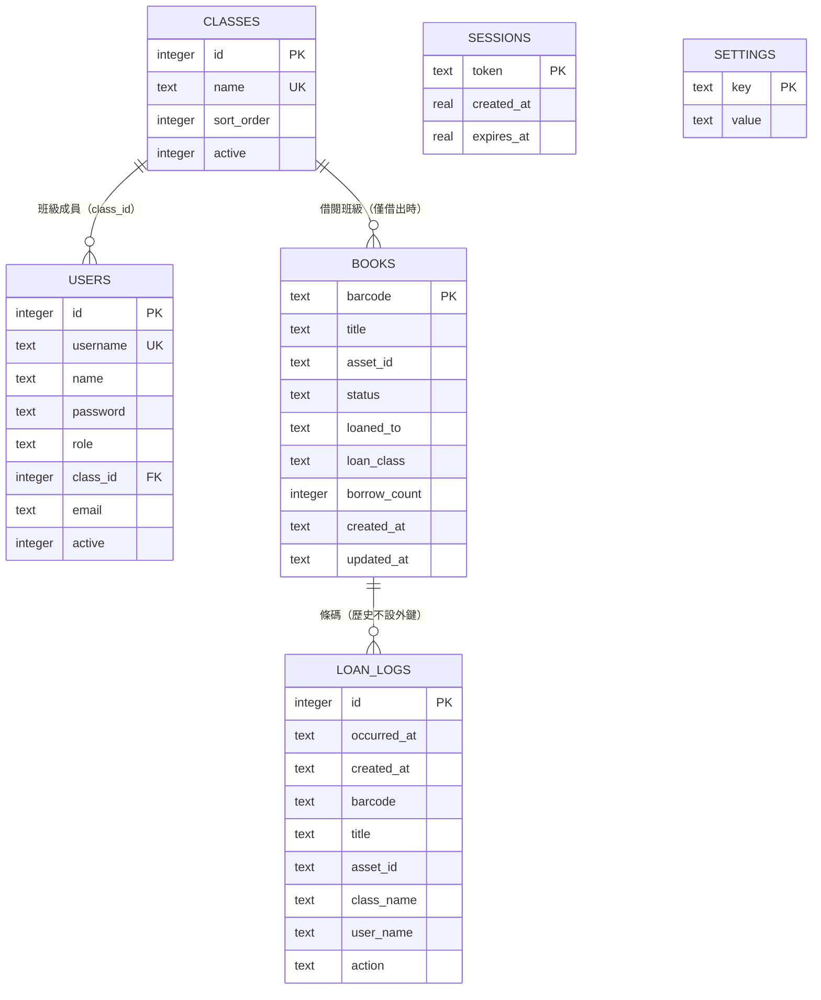

資料庫設計
==========

本文件說明 v2 版加入的 SQLite 後端。程式與資料庫結構分別位於：

| 檔案 | 用途 |
|---|---|
| `server.py` | HTTP 伺服器、REST API、靜態檔案、登入工作階段 |
| `schema.sql` | 資料表、索引、約束（伺服器啟動時自動建立） |
| `data/library.db` | 實際資料檔（不進版控） |

設計目標是「單機可離線、區網可共用」：不需要資料庫伺服器，也不依賴任何
npm / pip 套件，只要 Python 3 即可執行。


一、實體關聯
------------



`LOAN_LOGS` 刻意**不設**外鍵：永久刪除館藏後，借閱歷史仍必須保留。
`CLASSES.active = 0` 表示班級已從清單移除，但成員資料保留；重新加入班級時
會自動恢復，不會因調整班級清單而遺失成員。


二、資料表
----------

### settings
鍵值對。目前使用：

| key | 內容 |
|---|---|
| `admin_password` | `pbkdf2_sha256$迭代次數$salt$hash`，不存明碼 |

### classes
| 欄位 | 型別 | 說明 |
|---|---|---|
| `id` | INTEGER PK | 自動遞增 |
| `name` | TEXT UNIQUE | 班級名稱 |
| `sort_order` | INTEGER | 下拉選單順序 |
| `active` | INTEGER | 1 = 顯示於班級清單，0 = 停用但保留 |

### users
系統帳號，同時也是**唯一的班級成員名單**（v2.2 整併舊 `members` 表）。
`class_id` 有值＝班級成員（學生）；`class_id IS NULL`＝教職員／系統管理員。
`role` 支援 `admin`／`root`／`teacher`／`student`；`active = 0` 表示停用（軟刪除）。
`email` 供「忘記密碼」寄送驗證碼，可留空；`name` 為顯示用姓名。

| 欄位 | 型別 | 說明 |
|---|---|---|
| `id` | INTEGER PK | 自動遞增 |
| `username` | TEXT UNIQUE | 登入帳號；新增成員時自動編號 |
| `name` | TEXT | 姓名／顯示名稱，預設空字串 |
| `password` | TEXT | PBKDF2 雜湊字串 |
| `role` | TEXT | 預設 `teacher`；班級成員固定為 `student` |
| `class_id` | INTEGER FK → classes.id | 學生所屬班級；教職員為 NULL |
| `email` | TEXT | 救援信箱，預設空字串 |
| `active` | INTEGER | 1 = 啟用，0 = 停用 |
| `can_loan` / `can_member` / `can_book` / `can_config` / `can_report` | INTEGER | 功能權限旗標（借還書／班級成員／圖書管理／系統設定／報表列印），預設 0；admin/root 與共用管理員一律視為全開 |

新增班級成員時會自動建立同名的 `users` 資料列（帳號自動遞增、預設密碼 `1234`）。
移除成員只會設為 `active = 0`，重新加入同班同姓名時會恢復原本帳號、密碼與 Email。
舊版 `members` 表在伺服器啟動時會自動併入 `users` 後移除。
未分班教職員帳號（`class_id` 為 NULL）會一併列出，顯示在「教職員（未分班）」區塊，可由班級成員管理頁面的同一個清單維護；清單為唯讀（點擊開維護對話框），新增／修改／重設／刪除皆透過對話框完成。
### books
| 欄位 | 型別 | 說明 |
|---|---|---|
| `barcode` | TEXT PK | 條碼槍讀到的值 |
| `title` | TEXT | 書名 |
| `asset_id` | TEXT | 財產編號 |
| `status` | TEXT | `在館` / `借出` / `遺失` / `修繕中` / `爭議中` / `報廢`（CHECK 約束，v2.1 4.1） |
| `loaned_to` | TEXT | 借閱人姓名，僅借出時有值 |
| `loan_class` | TEXT | 借閱班級，僅借出時有值 |
| `borrow_count` | INTEGER | 累計借閱次數（手機版報表使用） |
| `remarks` | TEXT | 處理備註（v2.1 4.1） |
| `due_at` | TEXT | 到期日（`YYYY/MM/DD HH:MM:SS`），v2.1 1.3 借閱期限使用 |
| `call_no` | TEXT | 索書號／館藏分類編號（v2.1 4.5），預設空字串 |
| `isbn` | TEXT | ISBN 國際標準書號（版本身分，非館藏條碼），預設空字串 |
| `created_at` / `updated_at` | TEXT | 本機時間 |

索引：`status`、`loaned_to`，用於館藏列表與借閱狀態查詢。

### password_resets
忘記密碼驗證碼（v2.1 3.3）。只存 PBKDF2 雜湊，不存明碼；每次請求會把同目標的舊碼標為已使用。

| 欄位 | 型別 | 說明 |
|---|---|---|
| `id` | INTEGER PK | 自動遞增 |
| `target_key` | TEXT | `admin`（共用管理員）或 `user:<users.id>` |
| `target_email` | TEXT | 寄送對象（僅供除錯） |
| `code_hash` | TEXT | 6 位數驗證碼的 PBKDF2 雜湊 |
| `created_at` / `expires_at` | REAL | Unix 時間；預設 10 分鐘有效 |
| `attempts` | INTEGER | 已嘗試次數，上限 5 次 |
| `used` | INTEGER | 1 = 已使用／已失效 |
| `requester_ip` | TEXT | 請求來源 IP，供稽核 |

相關 settings：`admin_recovery_email`、`smtp_host`、`smtp_port`、
`smtp_security`、`smtp_username`、`smtp_password`、`smtp_from`。

### reservations
預約（v2.1 4.4）。只有借出中的書可預約。同一本書可以多人排隊（先到先得 FIFO，`id` 由小到大即為取書順位）。
書歸還時，排隊第一位自動結為 `ready`（可來取書）；該書在 `ready` 期間僅該成員可借取，逾期未取自動改為 `expired` 並遞補下一位；候取者亦可取消（`cancelled`）。

狀態欄位說明（含 CHECK 約束）：

| 欄位 | 型別 | 說明 |
|---|---|---|
| `id` | INTEGER PK | 自動遞增（即等候順位依據） |
| `created_at` | TEXT | 預約建立時間 |
| `expires_at` | TEXT | 等候期限（`pending` 建立時依 member_type 算）／候取期限（`ready` 歸還時重算） |
| `barcode` | TEXT | 被預約的書條碼 |
| `title` / `asset_id` | TEXT | 書名／財產編號快照 |
| `class_name` / `user_name` / `member_type` | TEXT | 預約班級、姓名、類型（student/teacher） |
| `status` | TEXT | `pending` / `ready` / `fulfilled` / `cancelled` / `expired`（CHECK 約束） |

狀態：

| 狀態 | 說明 |
|---|---|
| `pending` | 排隊中：等候該書歸還 |
| `ready` | 可來取書：書已歸還，本人限時來取（期限依 member_type 的借閱天數） |
| `fulfilled` | 已取書：本人借走該書 |
| `cancelled` | 已取消（含自己取消／逾期未取書） |
| `expired` | 逾期未取：`ready` 超過期限未借 |

索引：`barcode, status`、`user_name, status`。

索引：`barcode, status`、`user_name, status`。

### loan_logs
| 欄位 | 型別 | 說明 |
|---|---|---|
| `id` | INTEGER PK | 同時作為時間排序依據 |
| `occurred_at` | TEXT | 顯示用時間，`YYYY/MM/DD HH:MM:SS` |
| `created_at` | TEXT | 寫入時間，供日後日期範圍查詢 |
| `barcode` | TEXT | 條碼（不設外鍵） |
| `title` / `asset_id` | TEXT | 交易當下的書名與財編快照 |
| `class_name` / `user_name` | TEXT | 交易當下的班級與姓名快照 |
| `action` | TEXT | `借書` / `還書`（CHECK 約束） |

索引：`created_at DESC`、`barcode`。

### sessions
登入工作階段。`token` 為 32 bytes 隨機字串，存於 HttpOnly Cookie `sid`，
預設 12 小時過期；登入與啟動時會清除過期資料。
`user_id` 外鍵綁定 `users.id`（未填帳號登入時為 NULL，代表系統管理員備援）。


三、與舊版 localStorage 的對照
------------------------------

| 舊鍵 | 新位置 |
|---|---|
| `libConfig.password` | `settings.admin_password`（改為雜湊） |
| `libConfig.classes` | `classes`（`active = 1`） |
| `memberDB` | `users`（`class_id` 有值的資料列） |
| `bookDB` | `books` |
| `loanLogs` | `loan_logs` |

舊資料會在第一次登入時偵測並詢問是否匯入；匯入後以資料庫為準，
localStorage 不再作為資料來源（僅保留作為一次性搬移來源）。
管理密碼不會跟著舊資料匯入，仍使用 `settings.admin_password` 目前的值。

舊資料的 `status: "借出(王小明)"` 會在匯入時正規化為
`status = 借出`、`loaned_to = 王小明`，因此舊備份檔可直接匯入。


四、借還交易的併發處理
----------------------

多台電腦同時掃描時，若只靠前端檢查會發生「兩台都認為書在館」的超借。
因此借還一律送到伺服器，在單一交易中完成：

```text
BEGIN IMMEDIATE
  SELECT ... FROM books WHERE barcode = ?
  檢查 status（報廢 / 已借出 / 在館）
  UPDATE books
  INSERT INTO loan_logs
COMMIT
```

`BEGIN IMMEDIATE` 會先取得寫入鎖，搭配 WAL 模式與 `busy_timeout = 5000`，
確保同一本書只會被第一台裝置借出；第二台會收到 `409 Conflict` 與目前借閱人，
前端直接顯示「已被某人借閱中」。


五、API 一覽
------------

所有 `/api/*`（除 `health`、`login`、`session`）都需要登入 Cookie。

| 方法 | 路徑 | 用途 |
|---|---|---|
| GET | `/api/health` | 健康檢查（免登入） |
| POST | `/api/login` | 登入，設定 HttpOnly Cookie |
| POST | `/api/logout` | 登出並刪除工作階段 |
| GET | `/api/session` | 查詢目前是否已登入（免 401） |
| GET | `/api/state` | 班級、成員、館藏（不含借閱紀錄） |
| GET | `/api/logs?page=&pageSize=` | 借閱紀錄分頁（新到舊） |
| GET | `/api/logs.csv` | 匯出 CSV（UTF-8 BOM） |
| POST | `/api/loan` | 借書／還書（伺服器端驗證） |
| PUT | `/api/books/<barcode>` | 新增或修改館藏 |
| POST | `/api/books/<barcode>/scrap` | 報廢 |
| POST | `/api/books/<barcode>/restore` | 取消報廢 |
| DELETE | `/api/books/<barcode>` | 永久刪除（僅限已報廢） |
| POST | `/api/members` | 新增成員（學生自動建號；`staff` 為教職員） |
| DELETE | `/api/members?className=&name=` | 移除成員（帳號停用，不刪除） |
| DELETE | `/api/member-accounts/<id>` | 移除成員／教職員帳號 |
| GET | `/api/member-accounts` | 列出班級成員與教職員帳號 |
| PUT | `/api/member-accounts/<id>` | 修改姓名、帳號、Email |
| POST | `/api/member-accounts/<id>/reset-password` | 重設成員密碼 |
| PUT | `/api/classes` | 更新班級清單（移除者轉為停用） |
| PUT | `/api/password` | 修改管理密碼（其他裝置登出） |
| GET | `/api/backup` | 匯出完整 JSON 備份 |
| POST | `/api/import` | 匯入備份（覆蓋資料，保留密碼） |

回應中的 `bookDB`、`memberDB`、`libConfig` 欄位刻意維持舊版格式，
讓前端與舊備份檔不必大幅改寫。


六、容量估算
------------

| 資料 | 大小估算 |
|---|---|
| 一本書 | 約 150–250 bytes |
| 一筆借閱紀錄 | 約 200–300 bytes |
| 3,000 本館藏 | < 1 MB |
| 10 萬筆紀錄 | 約 20–30 MB |

SQLite 與舊版 localStorage（約 5–10 MB 上限）不同，容量以硬碟為準，
不需要定期清除紀錄。仍建議每月匯出備份。


七、安全設計
------------

- 密碼以 PBKDF2-HMAC-SHA256（200,000 次迭代、16 bytes salt）儲存。
- 登入後發放隨機 token，存於 `HttpOnly`、`SameSite=Lax` Cookie。
- 登入失敗以 IP 計數，5 分鐘內超過 10 次回傳 `429`。
- 所有 SQL 使用參數化查詢。
- 靜態檔案拒絕 `data/`、`server.py`、隱藏檔與路徑穿越。
- `data/library.db` 含幼兒姓名，請勿放入版控或公開分享。

**仍須注意**：這是單一共用密碼，不是多位老師各自的帳號，也沒有角色權限。
若需要逐人帳號與稽核紀錄，應再擴充 `users` / `audit_log` 表。


八、啟動與 HTTPS
----------------

```bash
python3 server.py                  # http://localhost:8000
python3 server.py --port 8080      # 指定連接埠
python3 server.py --db /path/db    # 指定資料庫位置
python3 server.py --https --cert cert.pem --key key.pem
```

相機掃碼需要「安全內容」：`localhost` 或 HTTPS。若老師從其他電腦以
`http://192.168.x.x:8000` 開啟，瀏覽器會封鎖相機；此時請：

1. 在該電腦使用條碼槍（不受影響），或
2. 以自簽憑證啟動 `--https`，或
3. 以反向代理（Caddy / Nginx）提供 HTTPS。
